# Sterntaler im Bild

Ein Rundgang durch die Anwendung: die beiden Hauptansichten, das vollständige Menü und alle
fünf Berichte.

> Alle Abbildungen zeigen eine **frei erfundene Beispielkasse** — „Förderverein Grundschule
> Musterstadt e. V." mit erdachten Mitgliedern, Buchungen und Testkontonummern. Es sind keine
> echten Vereins- oder Personendaten zu sehen.

Die Menüleiste erscheint hier im Fenster, wie unter Windows und Linux. Auf macOS sitzt
dieselbe Leiste am oberen Bildschirmrand.

## Ansichten

### Buchungen

Der Arbeitsplatz für die Kasse: alle Buchungen eines Kontos mit laufendem Saldo. Kategorie,
Aktivität, Geschäftsjahr, Kontoauszug und Rechnungsnummer lassen sich per Doppelklick direkt
in der Zeile ändern. Über **Spalten…** wird jede Spalte einzeln ein- und ausgeblendet, die
Suche springt von Treffer zu Treffer.

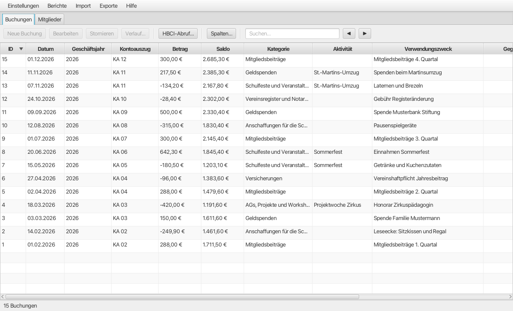

### Mitglieder

Dieselbe Bedienung für die Mitglieder, dazu die Umschaltung zwischen allen, aktiven und
inaktiven. Die Statuszeile unten rechnet Anzahl und Jahresbeiträge der angezeigten Auswahl
zusammen.

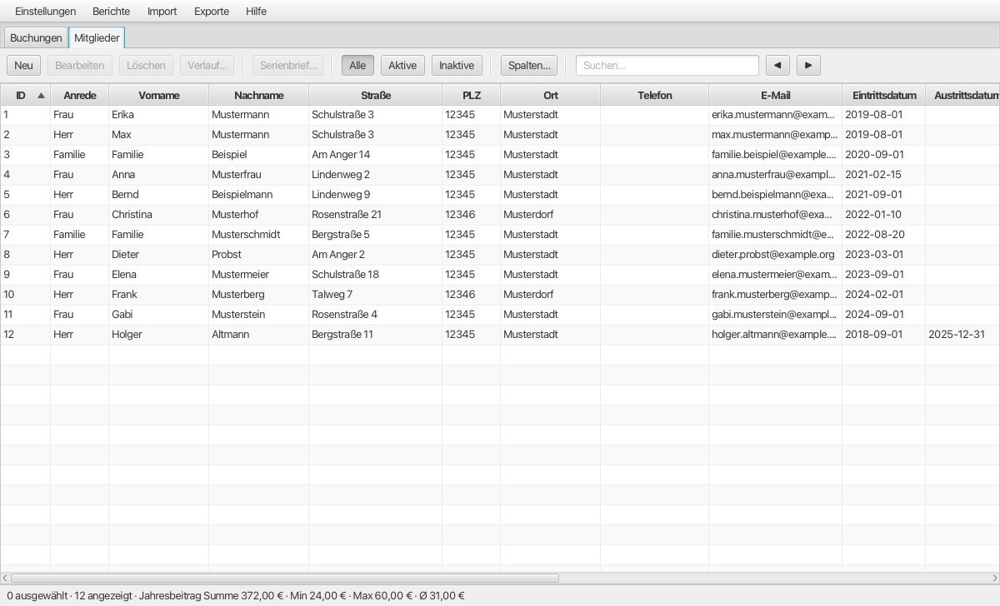

## Menüstruktur

### Einstellungen

Die Stammdaten, in der Reihenfolge, in der man sie beim Einrichten braucht: Verein, Konto,
Geschäftsjahre, dann Kategorien und Aktivitäten.

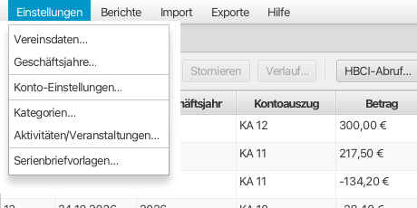

### Berichte

Die fünf Berichte, gruppiert: Kasse, Mitglieder, Steuer.

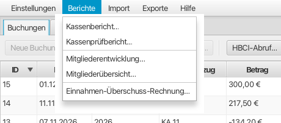

### Import

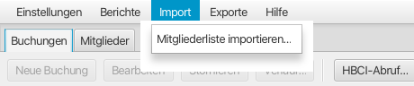

### Exporte

Neben den beiden Excel-Exporten die Sicherheitskopie, die alles auf einmal wegschreibt.

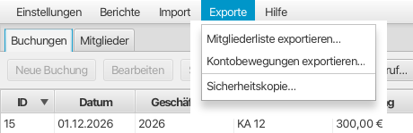

### Hilfe

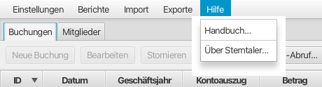

## Berichte

Alle Berichte entstehen als PDF mit Briefkopf aus den Vereinsdaten und Seitenzahlen.

### Kassenbericht

Der Jahresbericht für die Mitgliederversammlung: Einnahmen und Ausgaben je Kategorie,
Start- und Endsaldo, Unterschriftenzeile.

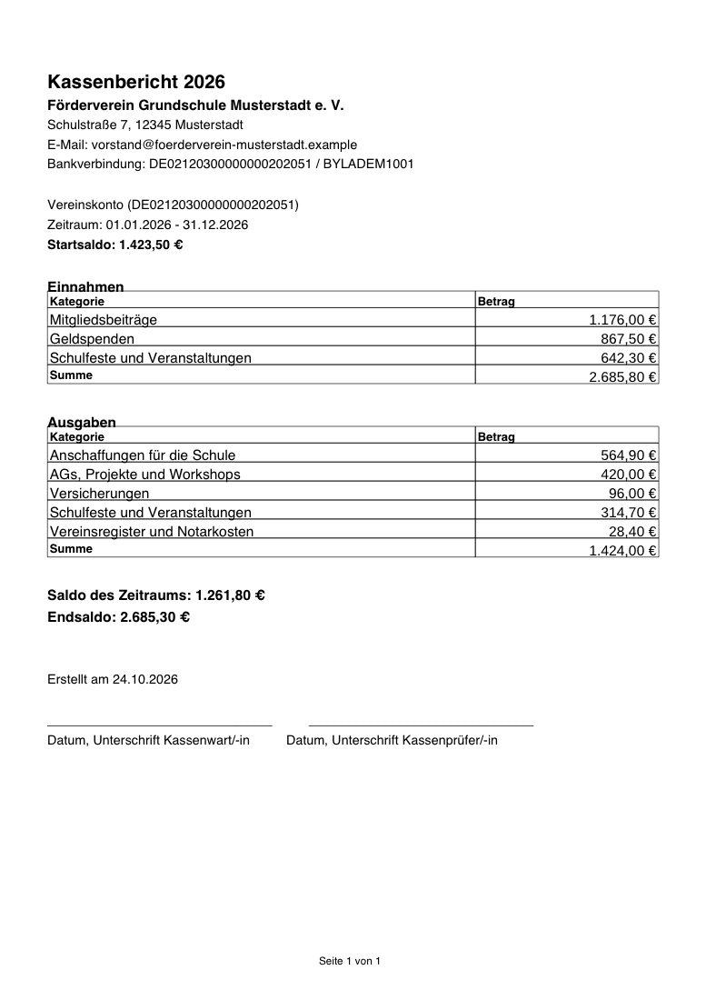

### Kassenprüfbericht

Jede einzelne Buchung des Jahres mit laufendem Saldo — der Beleg dafür, dass der Kassenbericht
stimmt. Im Querformat, weil acht Spalten im Hochformat nicht nebeneinander passen. Die zweite
Seite trägt Endsaldo, Entlastungsempfehlung und die Unterschriftenzeile.

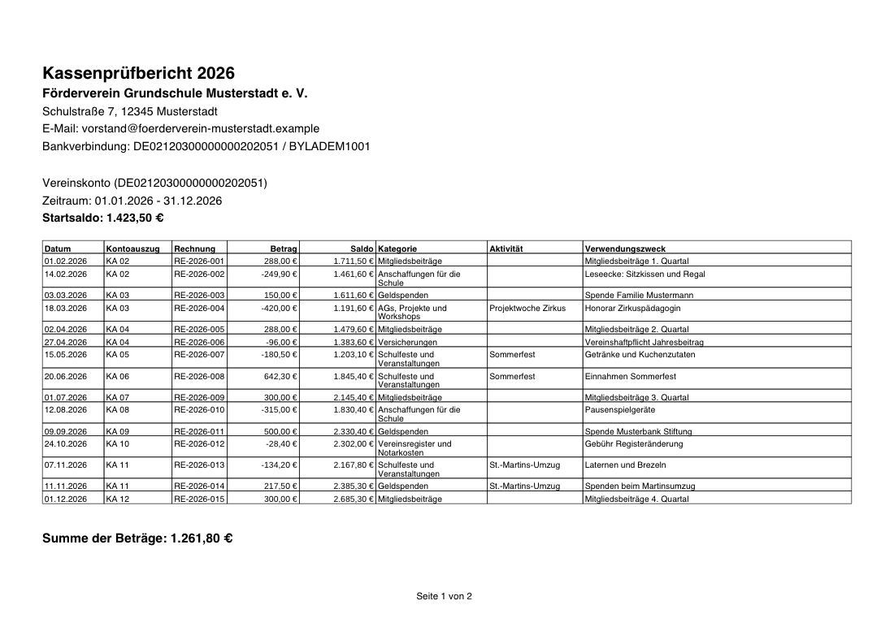

### Mitgliederentwicklung

Die Kennzahlen der aktiven Mitglieder: Anzahl und Jahresbeiträge als Summe, kleinster,
größter und Durchschnitt.

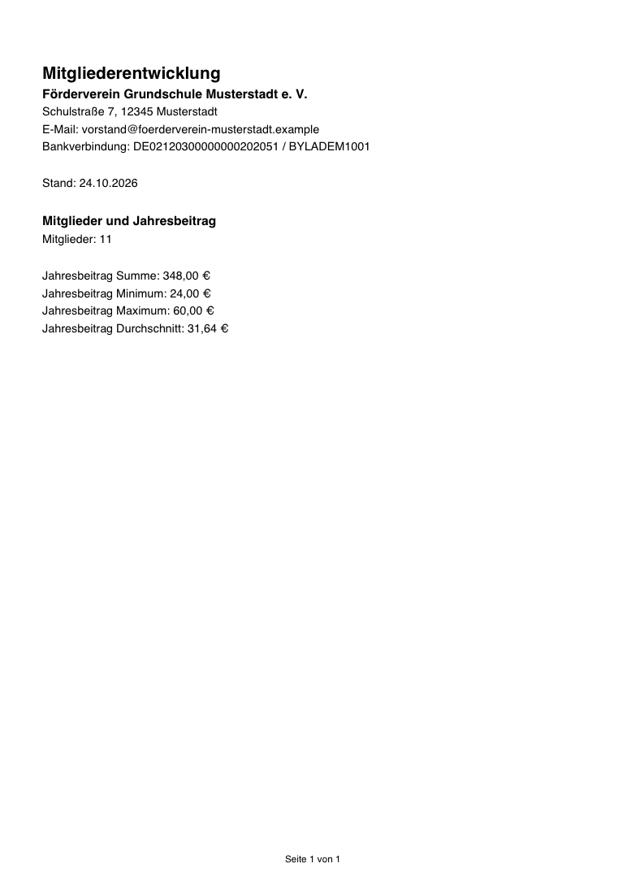

### Mitgliederübersicht

Alle aktiven Mitglieder mit ihren Stammdaten, nach Id sortiert. Im Querformat und in kleiner
Schrift, damit die fünfzehn Spalten nebeneinander passen.

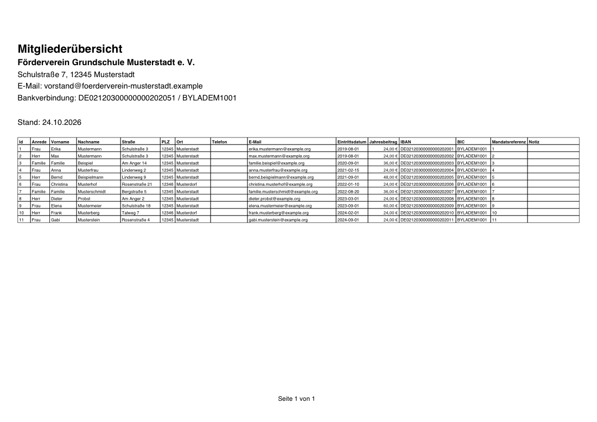

### Einnahmen-Überschuss-Rechnung

Für die Steuererklärung des Vereins: Einnahmen und Ausgaben, gegliedert nach den vier
steuerlichen Bereichen. Rechnet über das Kalenderjahr, nicht über das Geschäftsjahr.

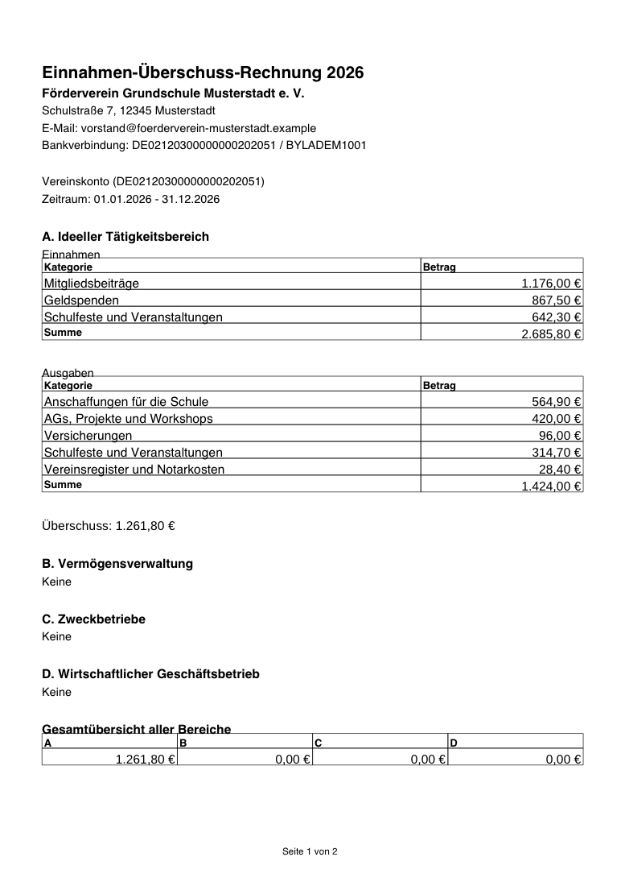

---

Wie die Anwendung bedient wird, steht im [Nutzerhandbuch](handbuch.md).
